<!-- markdownlint-disable MD033 MD041 -->
<div align="center">

<picture>
  <source media="(prefers-color-scheme: dark)" srcset="assets/banner/banner-dark.png">
  <source media="(prefers-color-scheme: light)" srcset="assets/banner/banner-light.png">
  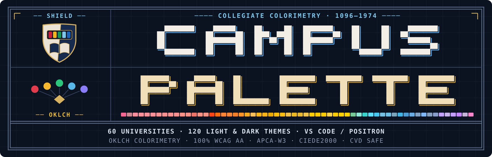
</picture>

# Campus Palette

**A Light and Dark color theme for iconic universities across North America and the world.**
60 universities · 120 themes · 6 collegiate groupings · 7 countries · one VS Code / Positron extension.

*An independent tribute to nearly a millennium of collegiate visual identities, institutional brand guidelines, and campus architectural atmosphere (1096–1974).*


[](https://idesofmerge.github.io/campus-palette/)
[](https://github.com/IDEsOfMerge/campus-palette/actions/workflows/build.yml)


-2A5F25?style=flat-square)


**[Launch the Live Interactive Workbench & Colorimetry Explorer ↗](https://idesofmerge.github.io/campus-palette/)**
*(Or run **`Campus Palette: Open Interactive Theme Explorer`** directly inside VS Code / Positron!)*

<br>

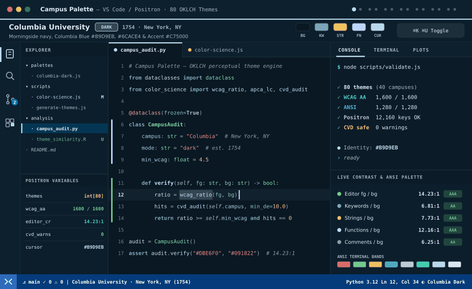

</div>

---

Every Light/Dark pair in **Campus Palette** is individually synthesized from its university's published institutional brand guidelines (primary, secondary, accent, and neutral hex specifications — linked directly in both the catalog below and the Interactive Explorer) and campus architectural atmosphere — never a generic syntax template reskinned onto a new background:

- **Columbia University** pairs sunlit Butler Library limestone (`#EEF5F9`), official Primary Blue (`#1D4F91`), and Accent Color 1 (`#C75000`) with Morningside Heights dusk slate (`#091822`) lit by iconic Philolexian Society Columbia Blue (`#B9D9EB`), Secondary Blue (`#6CACE4`), and Transactional Green (`#228848`).
- **University of British Columbia** anchors Point Grey morning mist and Pacific twilight directly in official UBC Blue (`#002145`) and its published secondary blue scale (`#0055B7`, `#0077C8`, `#40B4E5`, `#6EC4E8`), balanced with Coast Mountain cedar emerald and Burrard sunset amber.
- **University of Victoria** translates its coastal brand philosophy — *"blue ocean, green trees and yellow sun"* — into Salish Sea blue (`#005493`), Mystic Vale evergreen (`#008538` / `#26A739`), and Vancouver Island sun gold (`#F5AA1C` / `#FDB813`), with restrained Crest Red strictly for diagnostics.
- **St. Edward's University** draws straight from Austin's Hilltop visual identity: official Limestone (`#F7F3ED`), Sorin Navy (`#192E56`), Main Building Red Doors (`#EA4433`), Bluebonnet sky (`#8BCAEF`), and Gold Medallion (`#EDB920`).
- **Harvard, MIT, Stanford, Johns Hopkins, Carnegie Mellon, Waterloo, Dalhousie, Concordia, Oxford, Edinburgh, EPFL, ETH Zurich, Melbourne, Kyoto, NUS, and Imperial** join 40 additional campuses across six collegiate groupings and seven countries — from Dartmouth's official Rich Forest Green and Waterloo's six-faculty Level-4 spectrum to UT Austin's Burnt Orange & Teal system, CMU's Tartan palette, Edinburgh's Scottish Digital Design colours, EPFL's Swiss Lemán red & turquoise, Kyoto University's traditional *Nōsei* (`#00205B`), and NUS's Kent Ridge Blue & Orange.

Every palette is engineered and verified in **OKLCH** perceptual color space against **WCAG 2.1**, **APCA-W3**, **CIEDE2000** (`ΔE₀₀`), and **Machado et al. (2009)** physiological dichromacy simulation. Design inspiration comes strictly from **published brand color palettes and campus material atmosphere** — no university logos, crests, seals, mascots, wordmarks, or copyrighted graphics appear anywhere in this repository.

## The 60 universities, across 6 collegiate groupings

<picture>
  <source media="(prefers-color-scheme: dark)" srcset="assets/diagrams/founding-timeline-dark.png">
  <source media="(prefers-color-scheme: light)" srcset="assets/diagrams/founding-timeline-light.png">
  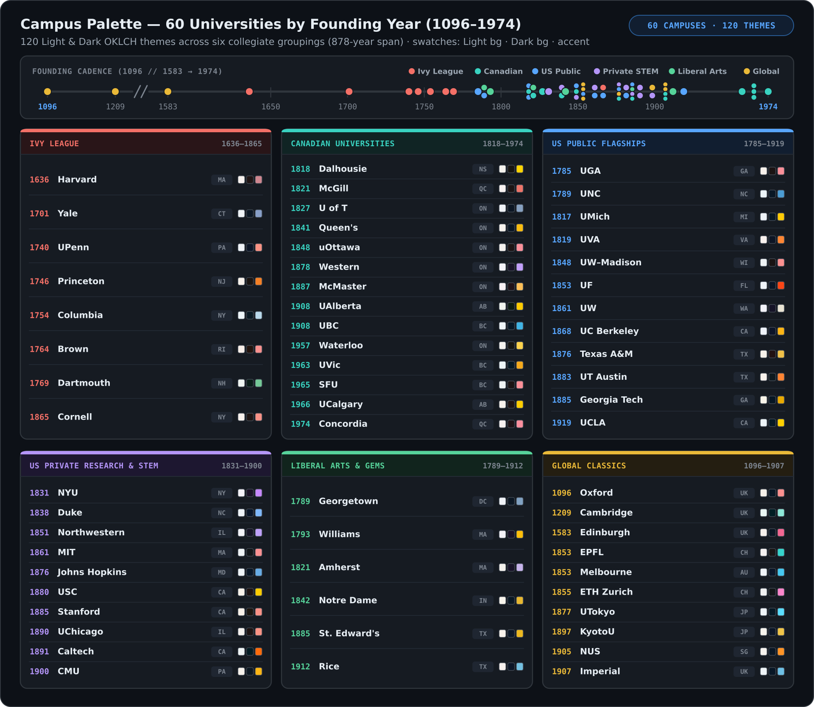
</picture>

## ...and along the Collegiate Heritage Metro Map

Organized as a six-line transit metro map spanning **1096 to 1974** — piecewise chronological spacing preserves medieval European foundations alongside North American, European, Asia-Pacific, and Australian research campuses across **Global Classics**, **Ivy League**, **US Public Flagships**, **Liberal Arts & Regional Gems**, **US Private Research & STEM**, and **Canadian Universities**:

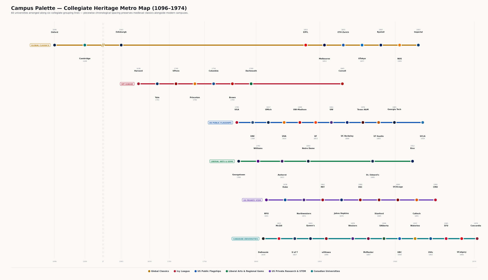

```sh
python3 scripts/generate-color-science-assets.py  # or: Rscript --vanilla analysis/timeline_metro.R
```

## Every pair tells a campus story

Four examples of how a Light/Dark pair maps official institutional brand color tokens and architectural materials to semantic code roles while clearing every contrast and colorblindness gate:

### Columbia University (1754 · New York, NY) — Butler limestone, Primary Blue & Philolexian Columbia Blue

 &nbsp; 

| Role | Light | Dark |
|---|---|---|
| Background | `#EEF5F9` sunlit Butler Library & Low marble | `#091822` Morningside Heights cobalt-slate night |
| Keywords | `#2F5980` Columbia Primary Blue (`#1D4F91`-anchored) | `#7BA5BA` luminous Columbia slate-azure |
| Strings | `#973D08` official Accent Color 1 (`#C75000` AA-tuned) | `#F1934A` luminous Accent Color 1 bronze-orange |
| Functions | `#1D3153` deep Hudson ink-blue (`#0077C8` / `#003087`) | `#BBD6FF` crisp Secondary Blue (`#6CACE4` glow) |
| Types | `#4A6B48` Transactional Green (`#228848` AA-tuned) | `#8ADBAB` sunlit Transactional Green emerald |
| Numbers | `#664A29` Alma Mater bronze gold | `#F7D086` gilded Alma Mater amber |
| **Identity chrome** | `#1D4F91` **Columbia Primary Blue (PMS 7686 C)** | `#B9D9EB` **Columbia Blue (PMS 290 C) cursor** |

### University of British Columbia (1908 · Vancouver, BC) — Point Grey mist, UBC Blue & Pacific Sky

 &nbsp; 

| Role | Light | Dark |
|---|---|---|
| Background | `#EFF5F8` Point Grey coastal morning mist | `#071725` deep Pacific twilight navy |
| Keywords | `#114C98` UBC Secondary Blue (`#0055B7` AA-tuned) | `#6AC0E4` official PMS 297 Sky (`#6EC4E8` hue) |
| Strings | `#993A08` Pacific red-cedar copper | `#EE9557` Wreck Beach sunset apricot |
| Functions | `#0B2295` deep Point Grey cobalt | `#81A5F8` luminous UBC azure |
| Types | `#046A4F` Pacific Spirit cedar green | `#87DAB9` Coast Mountain evergreen mint |
| Numbers | `#8C6032` driftwood & Burrard amber | `#F2D387` coastal golden hour |
| **Identity chrome** | `#002145` **UBC Blue (PMS 282) status bar** | `#40B4E5` **UBC Secondary Blue (PMS 298) cursor** |

### University of Victoria (1963 · Victoria, BC) — Salish Sea blue, Mystic Vale green & Island sun

 &nbsp; 

| Role | Light | Dark |
|---|---|---|
| Background | `#EDF5F7` sunlit Ring Road sea-breeze paper | `#051824` deep Salish Sea ocean midnight |
| Keywords | `#034493` **UVic Primary Blue** (`#005493` hue) | `#69A8C0` luminous Salish Sea azure |
| Strings | `#4D6F3B` Garry oak & coastal meadow green | `#7FA46D` Pacific rainforest lichen |
| Functions | `#063746` deep Haro Strait ocean-teal | `#78D3FC` **UVic Sky Blue** (`#57B7E7` glow) |
| Types | `#035539` Mystic Vale Douglas fir evergreen | `#81C647` sunlit canopy green (`#26A739` hue) |
| Numbers | `#875806` Vancouver Island deep ochre sun | `#FFCD75` bright Island sun gold |
| **Identity chrome** | `#005493` **UVic Primary Blue status bar** | `#F5AA1C` **UVic Sun Gold cursor & focus** |

### St. Edward's University (1885 · Austin, TX) — Hilltop Limestone, Sorin Navy, Red Doors & Gold Medallion

 &nbsp; 

| Role | Light | Dark |
|---|---|---|
| Background | `#F7F2EB` official **Limestone** (`#F7F3ED` warmth) | `#0B1727` Austin Hilltop **Sorin Navy** midnight |
| Keywords | `#941302` **Main Building Red Doors** (AA vermilion) | `#FB9381` luminous **Red Doors** (`#EA4433` hue) |
| Strings | `#0C6878` deep Texas Hill Country bluebonnet teal | `#63BDD0` twilight **Bluebonnet** cyan-teal |
| Functions | `#0D203A` **Sorin Navy** (`#192E56` deep ink) | `#B6DAF6` luminous **Bluebonnet Sky** (`#8BCAEF` hue) |
| Types | `#344F30` Hilltop Live Oak evergreen | `#90DAAA` South Congress live-oak mint |
| Numbers | `#7C5226` deep **Gold Medallion** ochre | `#FFCF57` glowing **Gold Medallion** (`#EDB920` hue) |
| **Identity chrome** | `#192E56` **Sorin Navy** bar & `#EA4433` **Red Doors** badge | `#EDB920` **Gold Medallion** cursor & `#8BCAEF` focus |

## The full catalog

<details>
<summary><strong>All 120 themes across 60 universities, grouping by grouping — click to expand</strong></summary>

Each university name links directly to its published institutional brand guidelines, and each local PNG swatch strip reads left to right: **background · keywords · strings · functions · types · numbers · status bar**.

<!-- CATALOG:START -->
### Ivy League (8 universities · 16 themes)

| University (Official Brand Guide) | Location & Founded | Light (bg · kw · str · fn · type · num · bar) | Dark (bg · kw · str · fn · type · num · bar) |
|---|---|---|---|
| **[Harvard University](https://seas.harvard.edu/office-communications/brand-style-guide/color-palette)** | Cambridge, MA · 1636 |  |  |
| **[Yale University](https://yaleidentity.yale.edu/core-identity-elements/yale-colors)** | New Haven, CT · 1701 |  |  |
| **[University of Pennsylvania](https://branding.web-resources.upenn.edu/web-identity)** | Philadelphia, PA · 1740 |  |  |
| **[Princeton University](https://communications.princeton.edu/guides-tools/logo-graphic-identity)** | Princeton, NJ · 1746 |  |  |
| **[Columbia University](https://visualidentity.columbia.edu/content/color)** | New York, NY · 1754 |  |  |
| **[Brown University](https://communications.sph.brown.edu/resources/identity)** | Providence, RI · 1764 |  |  |
| **[Dartmouth College](https://communications.dartmouth.edu/guides-and-tools/design-guidelines/dartmouth-colors)** | Hanover, NH · 1769 |  |  |
| **[Cornell University](https://brand.cornell.edu/design-center/colors/)** | Ithaca, NY · 1865 |  |  |

### Canadian Universities (14 universities · 28 themes)

| University (Official Brand Guide) | Location & Founded | Light (bg · kw · str · fn · type · num · bar) | Dark (bg · kw · str · fn · type · num · bar) |
|---|---|---|---|
| **[Dalhousie University](https://www.dal.ca/about/our-story/dal-brand.html)** | Halifax, NS · 1818 |  |  |
| **[McGill University](https://www.mcgill.ca/visual-identity/visual-identity-guide)** | Montreal, QC · 1821 |  |  |
| **[University of Toronto](https://adcomms.utoronto.ca/images/brand/assets/DefyGravity_BrandGuidelines-1.0.pdf)** | Toronto, ON · 1827 |  |  |
| **[Queen's University](https://www.queensu.ca/brand-central/visual-identity/colours)** | Kingston, ON · 1841 |  |  |
| **[University of Ottawa](https://www.uottawa.ca/about-us/administration-services/brand)** | Ottawa, ON · 1848 |  |  |
| **[Western University](https://brand.westernu.ca/visual-identity/colours.html)** | London, ON · 1878 |  |  |
| **[McMaster University](https://mph.healthsci.mcmaster.ca/wp-content/uploads/2022/05/brand-guidelines.pdf)** | Hamilton, ON · 1887 |  |  |
| **[University of Alberta](https://www.ualberta.ca/en/toolkit/digital-and-creative/email-best-practices/design-templating/templates.html)** | Edmonton, AB · 1908 |  |  |
| **[University of British Columbia](https://brand.ubc.ca/guidelines/downloads/ubc-colour-and-fonts/)** | Vancouver, BC · 1908 |  |  |
| **[University of Waterloo](https://uwaterloo.ca/brand/how-express-our-brand/colour)** | Waterloo, ON · 1957 |  |  |
| **[University of Victoria](https://www.uvic.ca/brand/brand-guidelines/colours-fonts/index.php)** | Victoria, BC · 1963 |  |  |
| **[Simon Fraser University](https://www.sfu.ca/communicators-toolkit/guides/brand-guide/colours.html)** | Burnaby, BC · 1965 |  |  |
| **[University of Calgary](https://www.ucalgary.ca/brand/standards-and-guidelines/colours)** | Calgary, AB · 1966 |  |  |
| **[Concordia University](https://www.concordia.ca/web/design/web-colour-palette.html)** | Montreal, QC · 1974 |  |  |

### US Public Flagships (12 universities · 24 themes)

| University (Official Brand Guide) | Location & Founded | Light (bg · kw · str · fn · type · num · bar) | Dark (bg · kw · str · fn · type · num · bar) |
|---|---|---|---|
| **[University of Georgia](https://brand.uga.edu/visual-identity/visual-style/)** | Athens, GA · 1785 |  |  |
| **[University of North Carolina](https://www.kenan-flagler.unc.edu/branding-guide/color/)** | Chapel Hill, NC · 1789 |  |  |
| **[University of Michigan](https://brand.umich.edu/design-resources/colors/)** | Ann Arbor, MI · 1817 |  |  |
| **[University of Virginia](https://brand.virginia.edu/design-assets/colors)** | Charlottesville, VA · 1819 |  |  |
| **[University of Wisconsin–Madison](https://brand.wisc.edu/visual-identity/colors/)** | Madison, WI · 1848 |  |  |
| **[University of Florida](https://brandcenter.ufl.edu/colors/)** | Gainesville, FL · 1853 |  |  |
| **[University of Washington](https://www.washington.edu/brand/brand-elements/colors/)** | Seattle, WA · 1861 |  |  |
| **[UC Berkeley](https://brand.berkeley.edu/visual-identity/colors/)** | Berkeley, CA · 1868 |  |  |
| **[Texas A&M University](https://marcomm.tamu.edu/creative-platform/visual-style/brand-colors/)** | College Station, TX · 1876 |  |  |
| **[University of Texas at Austin](https://umac.utexas.edu/brand-center/colors/)** | Austin, TX · 1883 |  |  |
| **[Georgia Tech](https://brand.gatech.edu/our-look/colors)** | Atlanta, GA · 1885 |  |  |
| **[UCLA](https://designsystem.brand.ucla.edu/build/v2.7.0/docs/style-guide/colors.html)** | Los Angeles, CA · 1919 |  |  |

### US Private Research & STEM (10 universities · 20 themes)

| University (Official Brand Guide) | Location & Founded | Light (bg · kw · str · fn · type · num · bar) | Dark (bg · kw · str · fn · type · num · bar) |
|---|---|---|---|
| **[New York University](https://www.nyu.edu/employees/resources-and-services/media-and-communications/nyu-brand-guidelines/designing-in-our-style/nyu-colors.html)** | New York, NY · 1831 |  |  |
| **[Duke University](https://brand.duke.edu/colors/)** | Durham, NC · 1838 |  |  |
| **[Northwestern University](https://www.northwestern.edu/brand/visual-identity/color-palettes/)** | Evanston, IL · 1851 |  |  |
| **[MIT](https://brand.mit.edu/color)** | Cambridge, MA · 1861 |  |  |
| **[Johns Hopkins University](https://brand.jhu.edu/visual-identity/colors/)** | Baltimore, MD · 1876 |  |  |
| **[University of Southern California](https://identity.usc.edu/identity/color/)** | Los Angeles, CA · 1880 |  |  |
| **[Stanford University](https://identity.stanford.edu/design-elements/color/)** | Stanford, CA · 1885 |  |  |
| **[University of Chicago](https://creative.uchicago.edu/color-system/)** | Chicago, IL · 1890 |  |  |
| **[Caltech](https://identity.caltech.edu/colors)** | Pasadena, CA · 1891 |  |  |
| **[Carnegie Mellon University](https://brand.cmu.edu/visual-identity/colors)** | Pittsburgh, PA · 1900 |  |  |

### Liberal Arts & Regional Gems (6 universities · 12 themes)

| University (Official Brand Guide) | Location & Founded | Light (bg · kw · str · fn · type · num · bar) | Dark (bg · kw · str · fn · type · num · bar) |
|---|---|---|---|
| **[Georgetown University](https://www.georgetown.edu/visual-identity/)** | Washington, DC · 1789 |  |  |
| **[Williams College](https://identity.williams.edu/)** | Williamstown, MA · 1793 |  |  |
| **[Amherst College](https://www.amherst.edu/news/communications/visual-identity-toolkit/colors)** | Amherst, MA · 1821 |  |  |
| **[University of Notre Dame](https://onmessage.nd.edu/university-branding/colors/)** | Notre Dame, IN · 1842 |  |  |
| **[St. Edward's University](https://www.stedwards.edu/faculty-staff/brand/visual-identity/color)** | Austin, TX · 1885 |  |  |
| **[Rice University](https://brand.rice.edu/colors)** | Houston, TX · 1912 |  |  |

### Global Classics (10 universities · 20 themes)

| University (Official Brand Guide) | Location & Founded | Light (bg · kw · str · fn · type · num · bar) | Dark (bg · kw · str · fn · type · num · bar) |
|---|---|---|---|
| **[University of Oxford](https://www.ox.ac.uk/about/the-university/brand/guidelines)** | Oxford, UK · 1096 |  |  |
| **[University of Cambridge](https://www.cam.ac.uk/brand-resources/guidelines/colour)** | Cambridge, UK · 1209 |  |  |
| **[University of Edinburgh](https://gel.ed.ac.uk/legacy/foundations/colour/)** | Edinburgh, UK · 1583 |  |  |
| **[University of Melbourne](https://designsystem.web.unimelb.edu.au/style-guide/colour-palette/)** | Melbourne, Australia · 1853 |  |  |
| **[EPFL](https://www.epfl.ch/campus/services/communication/wp-content/uploads/2019/03/EPFL-brand-guidelines.pdf)** | Lausanne, Switzerland · 1853 |  |  |
| **[ETH Zurich](https://ethz.ch/staffnet/en/service/communication/corporate-design/colours.html)** | Zurich, Switzerland · 1855 |  |  |
| **[University of Tokyo](https://www.u-tokyo.ac.jp/content/400236233.pdf)** | Tokyo, Japan · 1877 |  |  |
| **[Kyoto University](https://www.kyoto-u.ac.jp/en/about/profile/emblems/our-emblem-and-school-color)** | Kyoto, Japan · 1897 |  |  |
| **[National University of Singapore](https://www.nus.edu.sg/identity/guidelines/corporate-colours)** | Singapore · 1905 |  |  |
| **[Imperial College London](https://medlearnhelp.imperial.ac.uk/editing-content/web-guidelines-and-best-practices/design-excellence-section/web-design-style-guide/)** | London, UK · 1907 |  |  |
<!-- CATALOG:END -->

*(Swatch PNGs are generated locally by `scripts/generate-swatches.js` — no third-party badge service, no network dependency for viewers, nothing to go stale.)*

</details>

## Installing from the Marketplace or Open VSX

Search for **Campus Palette** in the Extensions view (`Ctrl+Shift+X` / `Cmd+Shift+X`) in VS Code, Positron, or any VS Code-compatible editor, or install from the command line:

```sh
code --install-extension idesofmerge.campus-palette
# or in Positron:
positron --install-extension idesofmerge.campus-palette
```

## Packaging & installing locally

Download `campus-palette-1.1.0.vsix` from the [GitHub Releases](https://github.com/IDEsOfMerge/campus-palette/releases) page, or build it locally from this repository root:

```sh
npm run package
code --install-extension campus-palette-1.1.0.vsix
# or in Positron:
positron --install-extension campus-palette-1.1.0.vsix
```

Or launch an Extension Development Host without packaging:

```sh
code --extensionDevelopmentPath="<full path to this folder>"
# or: positron --extensionDevelopmentPath="<full path to this folder>"
```

## Selecting & previewing themes

- **Campus Palette: Open Interactive Theme Explorer** (Command Palette or Welcome walkthrough): opens a 100% offline interactive workbench & colorimetry studio directly inside VS Code / Positron — filter all 60 universities by name, city, country, founding year, or collegiate grouping (`All · Ivy League · Canadian Universities · US Public Flagships · US Private Research & STEM · Liberal Arts & Regional Gems · Global Classics`), click **Official Brand Guidelines ↗** directly in the active theme Story Bar or inside the MDS Inspector Panel to open any institution's source brand palette, launch the **Interactive 2D CIEDE2000 MDS Similarity Map** (`M`) colored by Theme Swatch, Grouping, or Country (7 countries) with live `ΔE₀₀` hover inspection, hop directly between **Nearest Chromatic Neighbors** chips, launch **Side-by-Side Compare** (`C`) with dual OKLab polygons, preview Python / R / TypeScript / SQL / Quarto buffers, simulate Protanopia / Deuteranopia / Tritanopia in real time, export palettes for **VS Code**, **Ghostty**, **WezTerm**, **Alacritty**, **Windows Terminal**, **Kitty**, **iTerm2**, or **CSS variables**, copy stateful shareable links, and click **Apply to Workbench** to switch your editor theme on the fly. The exact same explorer is hosted live via **[GitHub Pages](https://idesofmerge.github.io/campus-palette/)**.
- **Campus Palette: Choose University Theme** (Command Palette or click the active theme badge in the bottom-right status bar): opens a grouping-organized quick-pick across all 60 universities (searchable by institution, city, country, founding year, or grouping) with **live theme preview** as you arrow up/down, architectural subtitle notes, an active indicator, and clean `Esc` rollback.
- **Campus Palette: Pick Chromatically Similar Theme**: opens a live-preview quick-pick showing your active campus's 6 nearest chromatic siblings sorted by exact `ΔE₀₀`, its paired Light/Dark counterpart, and its farthest same-mode contrast university (with `Esc` rollback).
- **Preferences: Color Theme** (`Ctrl+K Ctrl+T` / `Cmd+K Cmd+T`): standard alphabetical VS Code / Positron picker across all 120 themes.
- **Campus Palette: Random University Theme** & **Random Theme (Keep Light / Dark Mode)**: jump to a random campus across the catalog, or stay locked to your current Light or Dark polarity.
- **Campus Palette: Sync Light & Dark Pair with OS Appearance**: binds your active university's Light & Dark pair to `workbench.preferredLightColorTheme` and `workbench.preferredDarkColorTheme` and enables `window.autoDetectColorScheme` in one click.
- **Status Bar Badge Setting** (`campusPalette.showStatusBarItem`): toggle the bottom-right university theme quick-picker badge on or off (`true` by default).
- **Welcome: Open Walkthrough** → **Welcome to Campus Palette**: interactive first-run walkthrough covering campus selection, per-university Light/Dark toggling, institutional color craft, and launching the interactive Explorer.

## Smart Light ↔ Dark per-campus toggle

Run **Campus Palette: Toggle Light / Dark Theme** from the Command Palette or press `Ctrl+K Ctrl+U` (`Cmd+K Cmd+U` on macOS). Unlike a generic light/dark switch, it flips cleanly between the Light and Dark variant of **whichever university you're currently using** (e.g. *Columbia Light* ↔ *Columbia Dark*, *UBC Light* ↔ *UBC Dark*, *UVic Light* ↔ *UVic Dark*, *St. Edward's Light* ↔ *St. Edward's Dark*, *Oxford Light* ↔ *Oxford Dark*). If a non-Campus Palette theme is active, it starts on *Harvard Light*. Only standard `workbench.colorTheme` User settings are read or written.

## How the themes are built

<picture>
  <source media="(prefers-color-scheme: dark)" srcset="assets/diagrams/build-pipeline-dark.png">
  <source media="(prefers-color-scheme: light)" srcset="assets/diagrams/build-pipeline-light.png">
  
</picture>

Hand-authoring 447 workbench, Command Center, AI Chat/Inline Chat, Test Explorer, Terminal Sticky Scroll, TextMate, semantic-token, and Positron IDE keys across 120 themes doesn't scale by hand, so `scripts/generate-themes.js` expands each university's ~45-token brand palette (`palettes/*.js`) using OKLCH perceptual mixing, `scripts/generate-explorer.js` compiles both the static GitHub Pages (`site/index.html`) and VS Code Webview (`assets/explorer/explorer.html`) interactive explorers from those same modules, and `scripts/validate.js` + `test/*.test.js` enforce multi-gate colorimetric, zero-CDN CSP, and unit-test verification on every build (see [CONTRIBUTING.md](CONTRIBUTING.md) for details):

```sh
npm run build                            # regenerate themes/*.json, package.json, theme-metadata.json & Explorer bundles
npm run validate                         # audit all 120 themes, brandUrl links, Explorer CSP & 18,240 Positron key usages
npm test                                 # run 42 zero-dependency unit tests (node --test test/*.test.js)
npm run swatches                         # regenerate 120 local PNG palette strips in assets/swatches/
npm run package                          # package slim .vsix (README-only media excluded)
python3 scripts/generate-icon.py         # regenerate 4x supersampled 3D-beveled Light/Dark academic crest icon
python3 scripts/generate-banner.py       # regenerate Dark/Light banners & 1200x630 site/og-preview.png
python3 scripts/generate-diagrams.py     # regenerate Dark/Light founding-timeline & build-pipeline diagrams
python3 scripts/generate-showcase-gif.py # regenerate animated VS Code / Positron IDE showcase GIF
```

## Accessibility & perceptual contrast

Every single theme must clear strict automated perceptual gates before `generate-themes.js` or `validate.js` will succeed:

- **100% WCAG 2.1 AA compliance (`2,400 / 2,400` foreground & syntax tokens)**: all 20 foreground/syntax tokens in all 120 themes clear **≥ 4.5:1** on `editor.background` (measured range across the catalog: **`4.76:1` to `16.15:1`**) and **≥ 3.8:1** on `editor.lineHighlightBackground`.
- **APCA-W3 spatial contrast & WCAG AAA body text**: primary body text (`fg` on `bg`) achieves **`13.77:1` to `16.15:1` WCAG AAA** (**`|Lc| = 89.0` to `98.1`** APCA-W3) across all 120 themes, avoiding OLED halation in Dark mode while keeping Light limestone and paper surfaces calm and glare-free.
- **Figure–ground hierarchy**: comments (`fgComment`) sit in a tightly controlled **`6.00:1` to `6.40:1`** perceptual band across all 120 themes — effortlessly readable while staying subordinate to active code.
- **1,920 / 1,920 ANSI terminal tokens verified**: all 16 ANSI colors in every integrated terminal / Positron console clear contrast gates while preserving canonical terminal hue bands.

| Representative Theme | Editor `fg` / `bg` (WCAG) | Editor `fg` / `bg` (`|Lc|` APCA) | Comment / `bg` | Tightest syntax role / `bg` |
|---|---|---|---|---|
| **UBC Light** | `16.11:1` | `97.9` | `6.20:1` | `4.98:1` |
| **Columbia Light** | `16.10:1` | `97.9` | `6.16:1` | `5.47:1` |
| **UVic Light** | `15.98:1` | `97.6` | `6.11:1` | `5.20:1` |
| **St. Edward's Light** | `15.87:1` | `97.1` | `6.11:1` | `5.77:1` |
| **Harvard Light** | `15.84:1` | `96.8` | `6.15:1` | `6.02:1` |
| **ETH Zurich Light** | `15.62:1` | `96.1` | `6.00:1` | `5.37:1` |
| **UBC Dark** | `14.35:1` | `89.9` | `6.31:1` | `5.41:1` |
| **UVic Dark** | `14.33:1` | `90.0` | `6.31:1` | `5.67:1` |
| **Columbia Dark** | `14.23:1` | `89.7` | `6.25:1` | `5.60:1` |
| **St. Edward's Dark** | `14.19:1` | `89.5` | `6.25:1` | `4.77:1` |
| **Dartmouth Dark** | `13.93:1` | `89.9` | `6.12:1` | `5.48:1` |
| **Cambridge Dark** | `13.77:1` | `89.5` | `6.10:1` | `4.93:1` |

## Color science

Every theme's 13 adjacent syntax-relevant roles (`keyword`, `storage`, `string`, `regex`, `function`, `function-dim`, `type`, `interface`, `number`, `decorator`, `namespace`, `error`, `warning` — **1,560 syntax tokens** across 120 themes) are synthesized in Björn Ottosson's **OKLCH** perceptual color space and audited in **CIE 1976 `L*a*b*`** (`CIEDE2000` `ΔE₀₀` for normal-vision categorical distinctness and **Machado, Oliveira & Fernandes (2009)** physiological cone-matrix simulation for protanopia, deuteranopia, and tritanopia).

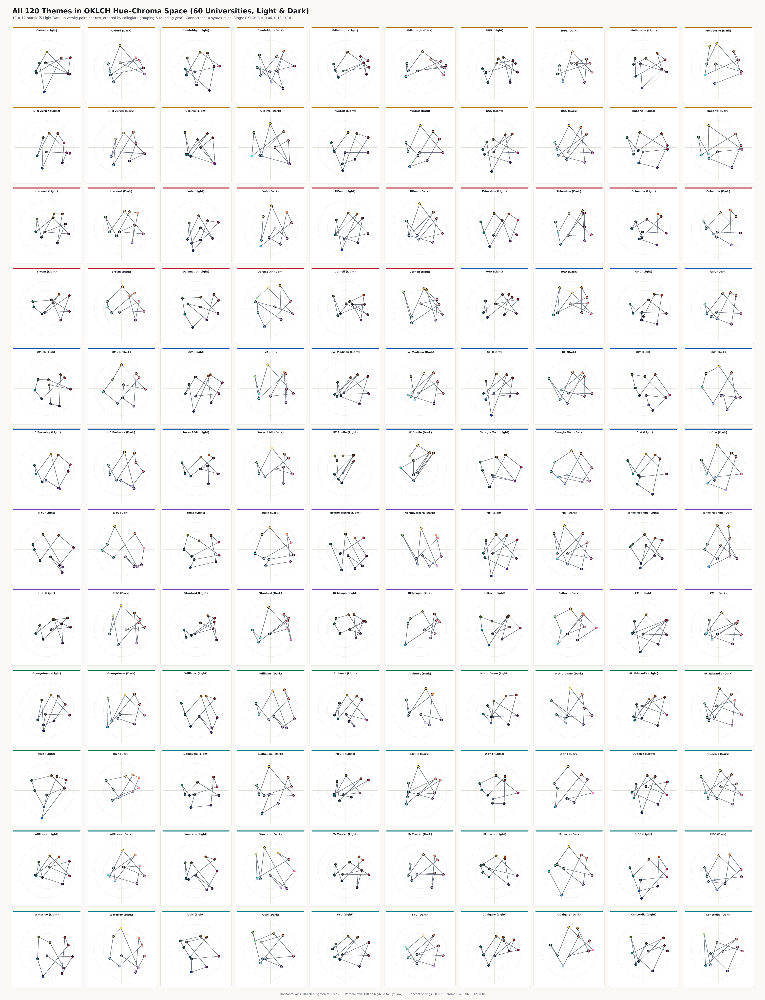

Plotting every theme's core syntax roles in the OKLab chromaticity plane and grouping their chromatic polygons across all six collegiate groupings reveals how each campus balances its signature brand hue with full-spectrum syntactic clarity:

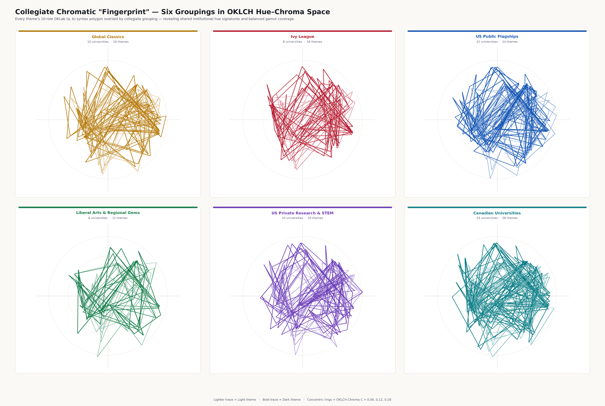

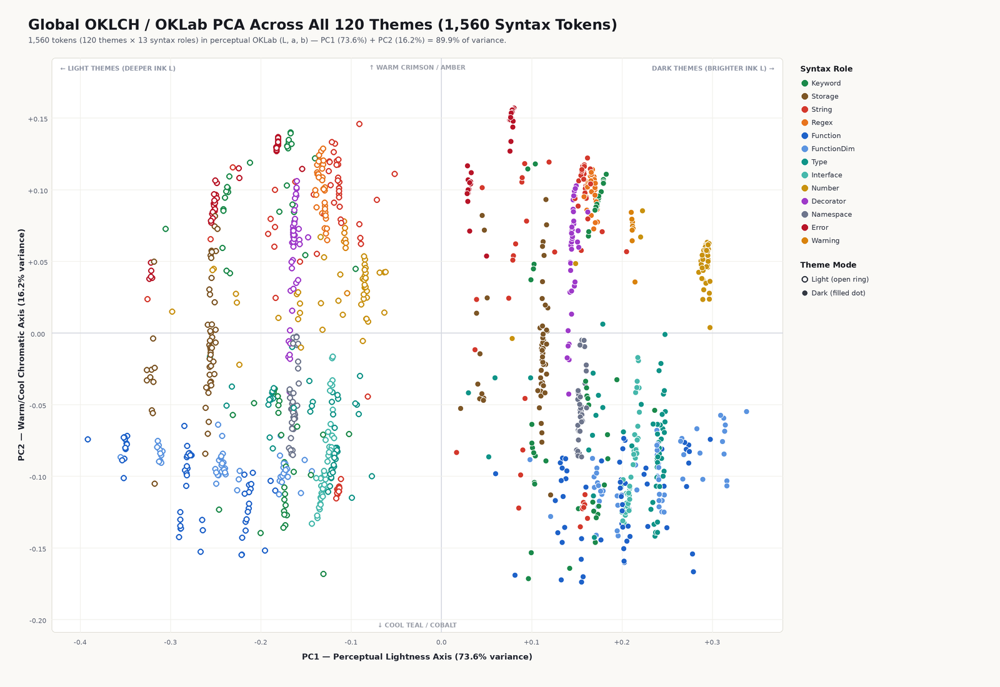

A global PCA across all **1,560 syntax tokens** in OKLab `(L, a, b)` space (`PC1 = 73.6%` perceptual lightness polarity, `PC2 = 16.2%` warm crimson/amber vs. cool teal/cobalt chroma — explaining **89.9%** of total perceptual variance in 2D) confirms clean Light/Dark separation alongside structured semantic role neighborhoods while honoring institutional keywords across crimson, cobalt, forest green, royal purple, and burnt orange.

### Which campus themes look like each other

Measuring mean **CIEDE2000 (`ΔE₀₀`)** distance across all 13 syntax roles between every pair of universities — factored by Light and Dark polarity so luminance never masks chromatic identity — maps all 60 campuses into a 2D **Classical MDS perceptual landscape** (`37.3%` of Light distance variance, `37.3%` of Dark distance variance), a **Ward-ordered 60×60 split-triangle distance matrix**, and a full **120-leaf Ward.D2 hierarchical dendrogram**:

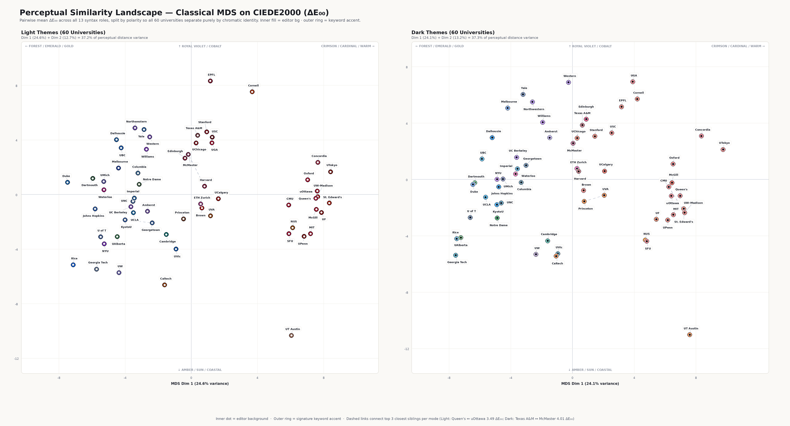

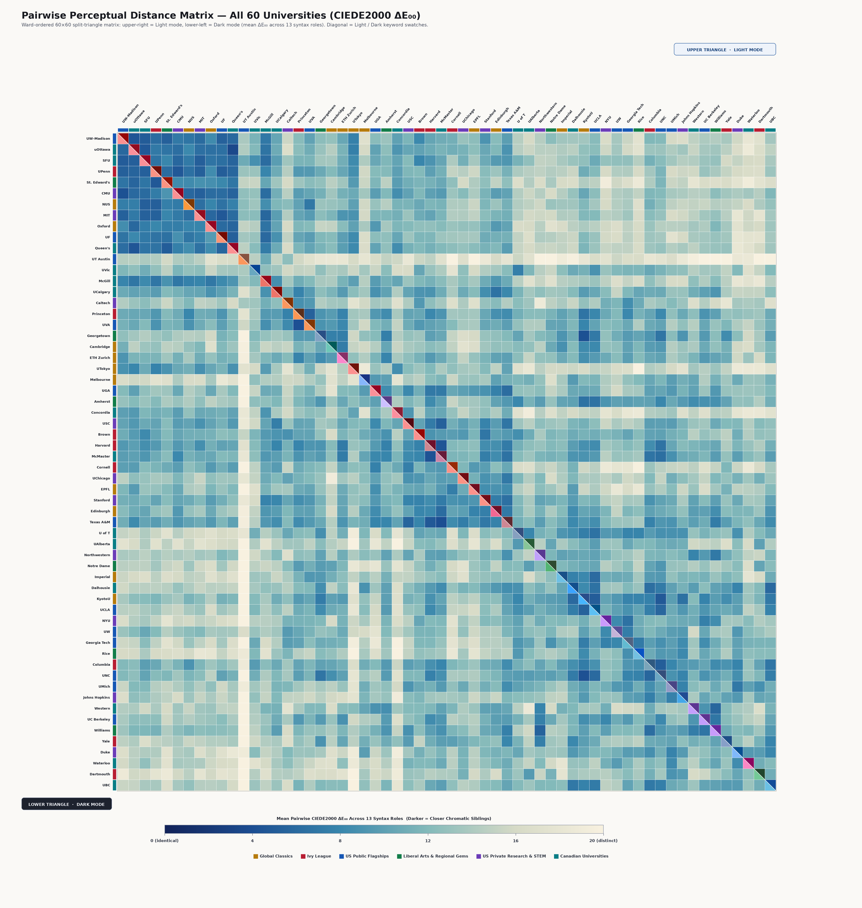

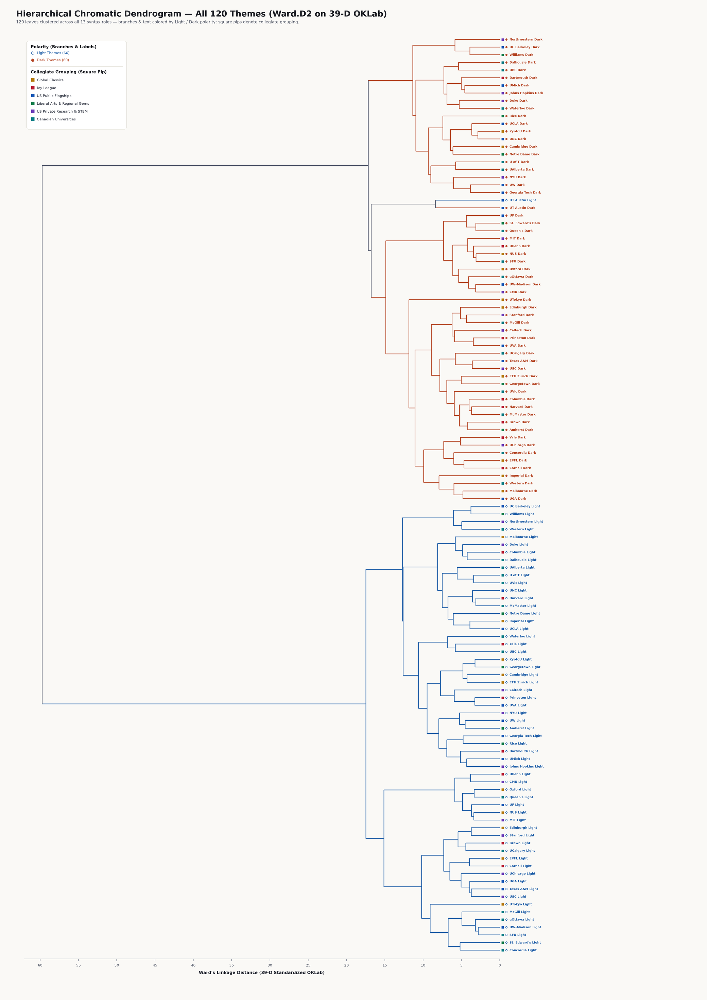

Three empirical patterns emerge directly from the colorimetry without any manual grouping:

1. **Shared institutional traditions form natural chromatic neighborhoods without collapsing**: drawing every secondary and accent token directly from each university's published brand guidelines keeps every single pair cleanly distinct (`≥ 3.49 ΔE₀₀` across all 3,540 same-mode pairs). The closest chromatic siblings reflect genuine visual kinship: **Queen's ↔ uOttawa** (`3.49 ΔE₀₀` Light — Canadian crimson/garnet & gold accents), **KyotoU ↔ Georgetown** (`4.19 ΔE₀₀` Light — deep institutional navy & architectural gray), **Texas A&M ↔ McMaster** (`4.01 ΔE₀₀` Dark — rich maroon/heritage burgundy & warm gold), and **Princeton ↔ UVA** (`4.08 ΔE₀₀` Dark — locked burnt/tiger orange).
2. **Maximally distinct chromatic opposites span the full perceptual gamut**: **UT Austin** (Burnt Orange `#BF5700`, Charcoal `#333F48`, Dark Teal `#005F86`, Turquoise `#00A9B7`, and Forest Green `#579D42` — respecting UT's official brand guideline against pairing red or purple with Burnt Orange) sits farthest from **Northwestern** (Northwestern Purple `#4E2A84` / `#401F68`) in *both* Light (**`21.73 ΔE₀₀`**) and Dark (**`24.14 ΔE₀₀`**) modes, closely followed by **EPFL ↔ UT Austin** (`21.72 ΔE₀₀` Light) and **Yale ↔ UT Austin** (`23.18 ΔE₀₀` Dark).
3. **Brand-policy structural pairing in Ward clustering**: across all 120 leaves in 39-D standardized OKLab space (max linkage height `59.75`), Light and Dark modes separate into two clean hemispheres while **UT Austin Light** and **UT Austin Dark** pair directly across the polarity boundary — uniquely united by UT Austin's official orange + teal + green (non-purple) palette across both polarities.

### Color-vision-deficiency (CVD) resilience via OKLCH lightness staggering

Categorical syntax palettes that rely purely on hue collapse under protanopia or deuteranopia. Every Campus Palette theme staggers its 7 critical adjacent syntax roles (`keyword`, `storage`, `string`, `function`, `type`, `number`, `error`) across **OKLCH perceptual lightness (`L`)** as well as hue so luminance separation survives all three cone deficiencies.

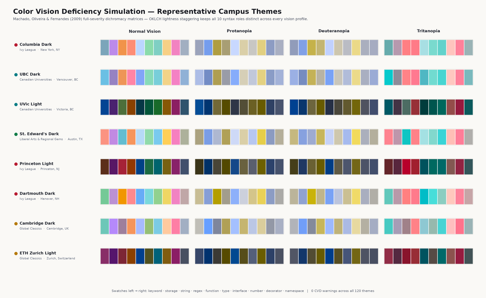

Across all **120 themes** (**`9,360`** audited role pairs and **`2,520`** critical adjacent syntax pairs × 3 dichromacy axes = **`7,560`** CVD checks):

- **0 severe collisions** (`< 5 ΔE*ab`) and **0 moderate collisions** (`< 10 ΔE*ab`) across all 120 themes under simulated protanopia, deuteranopia, and tritanopia.
- Every normally-distinct critical adjacent syntax pair (`≥ 15 ΔE*ab` in normal vision) across the entire 120-theme catalog maintains **`≥ 10.70 ΔE*ab`** under all three dichromacy models.

```sh
node scripts/export-color-data.js                  # export CSV datasets (themes, tokens, pairwise ΔE₀₀, CVD) to analysis/data/
python3 scripts/generate-color-science-assets.py   # regenerate all high-DPI PNG plots + Collegiate Heritage Metro Map
# Companion pure-R analytical scripts are also included:
Rscript --vanilla analysis/color_science.R
Rscript --vanilla analysis/theme_similarity.R
Rscript --vanilla analysis/timeline_metro.R
```

## Notes

- An independent, unofficial tribute to university visual identity palettes and campus architecture — not affiliated with, sponsored by, or endorsed by any institution featured in this collection.
- Zero runtime `npm` dependencies — `extension.js` uses only the built-in `vscode` API and static `theme-metadata.json`.
- Positron-specific workbench tokens (`positronConsole.*`, `positronVariables.*`, `positronPlots.*`, `positronDataExplorer.*`, etc.) are strictly validated against Positron's upstream color registry (**`18,240`** verified usages across 120 themes).
- No university logos, crests, seals, wordmarks, mascots, or copyrighted graphics appear anywhere in this repository — every visual (extension icon, README banners, Open Graph preview, animated IDE showcase GIF, 120 PNG palette strips, founding & pipeline diagrams, Collegiate Heritage Metro Map, and color-science plots) is generated algorithmically from hex coordinates and geometric primitives.

## License

MIT — see [LICENSE](LICENSE).
